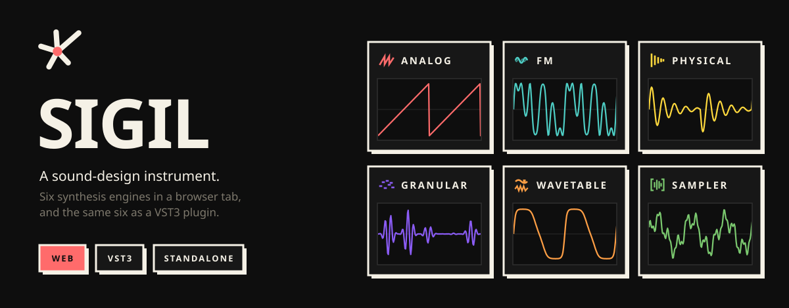

<p align="center">
  
</p>

<p align="center">
  <a href="https://sigil-production-26de.up.railway.app/start"><b>Play it in your browser</b></a> ·
  <a href="#run-it-locally">Run it locally</a> ·
  <a href="#build-the-plugin">Build the plugin</a> ·
  <a href="docs/MCP.md">Compose with Claude (MCP)</a>
</p>

SIGIL is a synthesizer for designing sounds. It runs in a browser tab, and the same engines run as a VST3
plugin and a standalone app on macOS. The plugin's audio is checked against the web version sample for
sample on every build, so a patch sounds the same in both.

## The six engines

| | Engine | What it does |
|---|---|---|
|  | **Analog** | Subtractive, with a four-pole ladder filter that self-oscillates. |
|  | **FM** | Four operators across the classic algorithms. Bells, electric pianos, metal. |
|  | **Physical** | Modelled resonators, struck or bowed. Wood, metal, glass and skin. |
|  | **Granular** | Audio cut into grains and rebuilt as clouds and drones. |
|  | **Wavetable** | Scanning banks of waveforms, so the timbre moves as it sounds. |
|  | **Sampler** | Your own recordings, through the same filters and envelopes. |

Every engine shares one effects chain and one character chain. There are about 84 presets across the six
banks, and **Hunt** breeds new patches from the ones you keep.

## Run it locally

You need **Node 22+** and **pnpm**.

```bash
git clone https://github.com/naramalhasaniWork/sigil.git
cd sigil
pnpm install
pnpm dev
```

Open http://localhost:3000. There is no passcode locally.

> [!TIP]
> Not a developer? Double-click **`SIGIL.command`** in the project folder instead. It installs what's
> missing, builds once, and opens the instrument in your browser. Details and per-browser support
> (MIDI, drag-to-DAW, camera hand tracking) are in [docs/RUNNING-LOCALLY.md](docs/RUNNING-LOCALLY.md).

`next dev` refuses to start a second instance, so if `pnpm dev` fails, one is already running.

### Configuration

Nothing is required to run locally. These only matter when you deploy.

| Variable | What it does |
|---|---|
| `SIGIL_PASSCODE` | Puts the whole app behind a shared passcode. Unset means open. |
| `NEXT_PUBLIC_SIGIL_PUBLIC=1` | The public build: no gate, arranger hidden, a `by naram` byline. |
| `SIGIL_ADMIN_KEY` | Enables `/admin` (sign-up list and export). |
| `SIGIL_MCP_TOKENS` | Bearer tokens for the MCP server. Mint one with `node scripts/mcp-token.mjs <name>`. |
| `DATABASE_URL` | Postgres for sign-ups. Without it they are kept in memory. |
| `NEXT_PUBLIC_SITE_URL` | Absolute URL for social cards on a custom domain. |

## Build the plugin

macOS on Apple Silicon. You need CMake 3.20+, the Xcode Command Line Tools, and a JUCE checkout.

```bash
# 1. JUCE, once
git clone https://github.com/juce-framework/JUCE.git ~/JUCE

# 2. Bundle the interface into the plugin. Run this every time the UI changes.
node scripts/build-plugin-ui.mjs

# 3. Configure and build
cmake -S native -B native/build-plugin -DSIGIL_BUILD_PLUGIN=ON
cmake --build native/build-plugin --config Release

# 4. Test, then install
(cd native/build-plugin && ctest)
cp -R native/build-plugin/SIGIL_artefacts/Release/VST3/SIGIL.vst3 ~/Library/Audio/Plug-Ins/VST3/
```

A Standalone `.app` is built next to the VST3. It's the fastest way to try a change without a DAW.

> [!WARNING]
> Skipping step 2 ships an old interface without any error. It once went unnoticed for a day.

**In Ableton Live:** quit Live completely before testing a new build, because a running Live keeps the
plugin it loaded at launch. Then turn on **Settings → Plug-Ins → Use VST3 Plug-In System Folders**. More
in [docs/ableton-today.md](docs/ableton-today.md).

**Logging:** create `~/Library/Logs/SIGIL/on` and the plugin writes its lifecycle (state save and restore,
editor open, every parameter the page writes) to `~/Library/Logs/SIGIL/plugin.log`. Delete the file to
turn it off. It never touches the audio thread.

## One DSP, two hosts

<p align="center">
  
</p>

`src/dsp/` is the reference implementation. `native/src/` is a hand-written C++ port of it, and the two have
to make the same sound. The drift gate measures that:

```bash
pnpm run drift      # render goldens from the current TypeScript, then compare the C++ (197 checks)
```

Goldens are regenerated from the TypeScript on every run instead of being checked in, so they can't drift
along with the code that made them. **Any change to `src/dsp/` must be mirrored in `native/src/`.**

## Tests

```bash
pnpm test                                   # about 954 tests
NODE_OPTIONS=--expose-gc npx vitest run     # what CI runs
```

Keep `--expose-gc`. Several tests assert that render loops allocate nothing, and without a real `gc()`
they pass while measuring nothing.

When you add a test, break the code it covers and watch it fail. Three tests here once passed against
deliberately broken code. And a green suite is not a working instrument: open it in a browser and play it.

## What's where

| Path | Contents |
|---|---|
| `src/dsp/` | The synthesis. Plain TypeScript, no allocation in render loops, no browser APIs. |
| `src/audio/` | The bridge from DSP to host: an AudioWorklet in the browser, a processor in the plugin. |
| `src/ui/` | The interface. React, shared by the web app and the plugin. |
| `src/mcp/` | The MCP server's tools ([docs/MCP.md](docs/MCP.md)). |
| `app/` | Next.js routes: the instrument at `/`, the landing page at `/start`, `/admin`, the API. |
| `native/` | The C++ port of `src/dsp` and the JUCE plugin around it. |
| `docs/` | Design rulings, the sound audit, running locally, MCP. |

## Working on the code

**Parameters are appended, never inserted.** The plugin maps parameters to VST3 parameters by index, so
inserting one mid-list re-targets automation in every saved project. Patches are keyed by id
(`src/audio/patch-format.ts`); host automation is not.

**The worklet is a separate realm.** It is bundled on its own and holds its own copy of every module.
State set on the main thread never reaches it.

**Denormal and NaN guards in the DSP are load-bearing.** Carry them across when porting.

**Design rules.** Midnight neo-brutalism: `#0E0E0E` background, `#171717` panels, `#F5F1E6` ink, 3px
borders, sharp corners, flat fills, hard offset shadows only on things you can press. No gradients or
blur. Readable text is ink, never `--muted` (it fails WCAG AA on panels). Touch targets are at least
44px, because people play it on a phone. Files stay under 300 lines, TypeScript strict, no `any`.

## License

Source-available, all rights reserved. You may read the code and run it locally for yourself.
Redistribution, resale, or shipping it in another product needs written permission.
